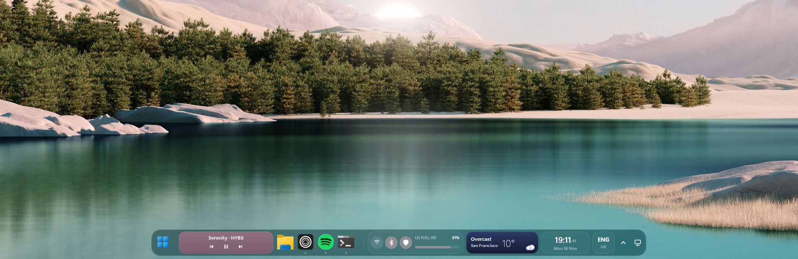

<h1 align="center">SereneBar</h1>

<p align="center"></p>

A native Windows 10/11 dock.

## Should I use this?

Not really. This is an experimental project that would unlikely to be maintained. Use [lumabar](https://lumabar.xyz) instead.

## Widgets

- **Start** (`start`): the Windows 11 Start logo
- **Apps** (`apps`): the dock's pinned apps, then other open apps in the order they opened
- **Music** (`media`): a pill tinted with the album art's colour, with "Title · Artist" and prev/play/next.
- **Weather** (`weather`): condition, city and temperature on a blue tile.
- **Clock** (`clock`): It's a clock, what more to say about it.
- **Claude** (`claude`) and **Codex** (`codex`): session and weekly plan limits with time to reset.
- **Antigravity** (`antigravity`): Gemini's session and weekly limits on your Google AI plan, plus the pool for Claude and GPT models, read from the sign-in the Antigravity CLI (`agy`) keeps on this PC.
- **DeepSeek** (`deepseek`): what's left on your DeepSeek API account. Add your API key under Settings › Feeds & accounts; it's kept encrypted for your Windows account.
- **Quick controls** (`controls`): pick its buttons in Settings: Wi-Fi, Bluetooth, VPN, airplane mode, mobile hotspot, volume (click the bar, or scroll anywhere on the tile) and battery. The rest of the tile opens a panel with every app's own volume too.
- **Hidden icons** (`tray`): a chevron that opens the notification-area icons in a grid above it.
- **Show desktop** (`desktop`): minimises everything, or brings it back (Win+D).
- **Network speed** (`network`): download and upload speed of the network adapters. Clicking it opens Task Manager.
- **Light and dark** (`theme`): switches Windows apps and the taskbar between light and dark mode.
- **Day, month, year** (`progress`): how much of today, this month and this year has gone by, as three rings.
- **Mute and deafen** (`mic`): two buttons, lit red while on: mute every microphone, and mute the speakers.
- **Input language** (`lang`): the keyboard layout of the window in front, like ENG / US. Clicking it opens Windows' language switcher (Win+Space).

## Downloads

Check out [releases](https://github.com/gxjakkap/serenebar/releases)

## Build & run from src

```powershell
# rustup from https://rustup.rs (MSVC toolchain)
cargo build --release
.\target\release\serenebar.exe
```

## License
[see LICENSE](LICENSE)
